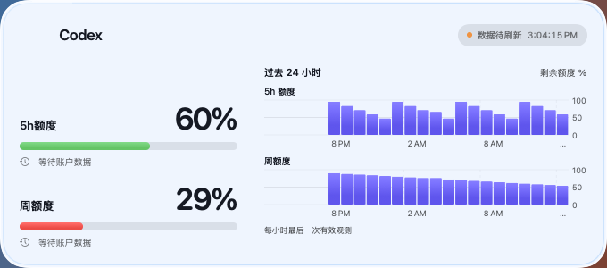
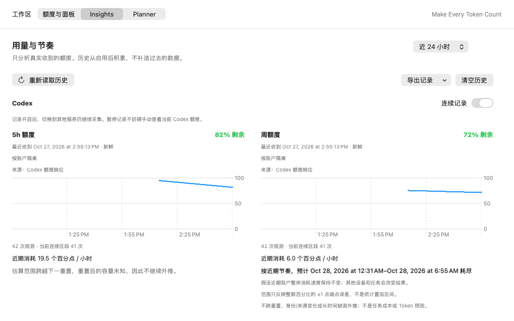
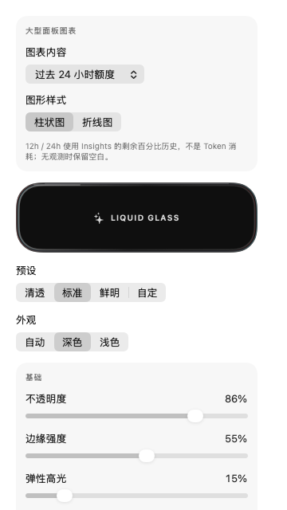

<p align="center">
  
</p>

<h1 align="center">Tallygent</h1>

<p align="center">Your agent quota, in view. Your next move, explained.</p>

<p align="center">
  <a href="https://github.com/tonig0709/Tallygent/releases/latest"></a>
  <a href="https://github.com/tonig0709/Tallygent/actions/workflows/test.yml?query=branch%3Amain"></a>
  
  
  <a href="LICENSE"></a>
</p>

<p align="center">
  <a href="https://github.com/tonig0709/Tallygent/releases/download/v0.8.0/Tallygent-v0.8.0-macOS.dmg"><strong>Download for macOS</strong></a> ·
  <a href="https://github.com/tonig0709/Tallygent/releases/tag/v0.8.0">Release notes</a> ·
  <a href="https://github.com/tonig0709/Tallygent/releases/download/v0.8.0/Tallygent-v0.8.0-checksums.txt">SHA-256 checksums</a>
</p>

Tallygent is a local-first macOS app for monitoring **Codex** and, experimentally, **Claude Code**. Follow your **12/24-hour quota history**, keep a movable Liquid Glass panel on your desktop, and get explainable model-and-effort suggestions without granting permission to run tasks.

<p align="center">
  
</p>

The gallery uses native demo-data captures from **v0.7.1 / build 52**, before the multilingual update; it is not a personal account. Current UI text follows your system language. [Capture details and limitations](docs/SCREENSHOTS.md).

## Available languages

**English · 简体中文 · 繁體中文** — available in v0.8.0. Tallygent automatically follows your Mac’s preferred language, including any per-app language override. Other languages fall back to English. Relaunch after changing language; date, time and number formats follow your system region. [Localization details](docs/LOCALIZATION.md).

README: **English** · [简体中文](README.zh-CN.md) · [繁體中文](README.zh-TW.md). These links switch the document, not the app.

## Why Tallygent?

- **See how your quota changes.** Switch the large panel between 12-hour or 24-hour history, with bars or lines. Keep the original seven-day Token chart when you want daily totals instead.
- **Keep just enough on your desktop.** Choose small dual rings, medium quota bars, or a large quota-and-history panel. Swipe between sizes in the app; only one desktop panel is open at a time.
- **Make the glass yours.** Light, dark, or automatic appearance; live opacity, corner, frost, edge, and highlight controls. Drag from the panel body. Edge controls appear on hover and disappear when you move away.
- **Go from monitoring to planning.** Insights explains observed usage pace. Planner combines your task, available local models, quota windows, and reserve preference to suggest a Model + Effort configuration, with reasons and explicit uncertainty.
- **Stay in control.** History stays local. Tallygent does not start agents, execute code, or move tasks between providers automatically.

**Hourly history means remaining-quota percentages, not hourly Token consumption.** Missing observations stay empty; resets and long gaps are not joined into a misleading line. See [chart semantics](docs/PANEL_TRENDS.md).

## Screenshots

### A lighter view, with 24-hour bars



Each bar is the last valid quota observation in that hour. The 5-hour and weekly limits remain separate constraints, not a combined balance.

### Insights: history with context



Inspect observation freshness, history, and recent pace. Estimates are withheld when history is insufficient or stale; they are not promises that a task will fit.

### Live glass and chart controls



The app preview and the single desktop panel share settings. These are native rendered views, not AI-generated mockups; actual wallpaper blending and pointer effects require the installed app on a real desktop.

## Download and get started

**Current stable release: [v0.8.0 (build 54)](https://github.com/tonig0709/Tallygent/releases/tag/v0.8.0).** Requires **macOS 14+**; one universal app supports **Apple Silicon and Intel**. There is no Windows or iOS build.

1. [Download the DMG](https://github.com/tonig0709/Tallygent/releases/download/v0.8.0/Tallygent-v0.8.0-macOS.dmg). Choose the `.dmg` asset, not GitHub's **Source code** archive.
2. Drag **Tallygent.app** into **Applications**, eject the disk image, then launch the installed app.
3. For Codex, install and sign in to Codex CLI or a supported Codex/ChatGPT Mac app that includes Codex. Select **Codex** in Tallygent.
4. Choose a panel size and click **Desktop Glass Panel** (`桌面玻璃面板`). Use **Glass Settings** (`玻璃设置`) to adjust its appearance and chart.
5. Keep Tallygent running to collect new observations. Closing the panel does not quit the app; reopen it from the app or menu bar.

> **Signing notice:** the current DMG is **ad-hoc signed, not Apple-notarized**. macOS may require an additional first-open approval. Verify the published checksum and source before opening; do not disable Gatekeeper. A checksum verifies file integrity, not Apple's approval. See [Security](SECURITY.md).

**Upgrading from Codex Quota?** Tallygent is the renamed app. Quit the old copy and keep only one active installation. Preferences, panel ownership, and data identities are preserved; do not delete local data to upgrade. Remove any old desktop WidgetKit widgets manually: the current product uses independent movable panels, **not the system widget gallery**. Stable Liquid Glass and the [particle experiment](docs/PARTICLE_DEVELOPMENT.md) remain separate.

## Choose your panel

| Size | Dimensions | What you see |
| --- | --- | --- |
| Small | 164 × 164 pt | Dual rings for 5-hour and weekly quota |
| Medium | 344 × 164 pt | Provider identity and two quota bars, without a chart |
| Large | 680 × 300 pt | Quota, reset times, status, and seven-day Token or 12/24-hour quota charts |

Swipe left or right in the preview, or use its arrows and size buttons. Switching size updates the same panel and preserves its top-left position. Glass parameters are shared across sizes. Remaining quota is **green at ≥60%, orange at 30–<60%, and red below 30%**.

## Providers and refresh behavior

### Codex

The main app owns the Codex app-server connection. It polls every **15 seconds** and responds to quota-change notifications; the desktop panel observes the same state directly, without WidgetKit refresh budgets. Valid observations feed the local history and charts automatically. If Token history times out, new quota can still appear while the last valid Token chart is retained.

Actual freshness depends on the provider, network, and available account data. The large panel's **second-by-second Mac clock is not a quota refresh indicator**; hover over the status to inspect the actual data-update time.

### Claude Code · experimental

Opt in to the local [statusLine bridge](https://code.claude.com/docs/en/statusline), then run a Claude Code session that supplies `five_hour` and `seven_day` subscription-limit fields.

- This is **passive session input**, not background polling of Claude's subscription server. The app checks the local cache every two seconds; Refresh cannot force new upstream data.
- No subscription or missing fields means **unavailable**, never a fabricated 0%. Expired reset windows show pending data rather than carrying an old balance into a new cycle.
- One session is bound at a time. Rebind explicitly to switch; multiple sessions are not silently merged.
- An existing third-party `statusLine` is not overwritten. Setup backs up the local settings, and removal restores only Tallygent-managed configuration.
- Real subscription behavior and compatibility across Claude Code versions still need real-account validation. No Claude seven-day Token chart is claimed.

## Local data, clear limits

- Codex manages its own login and credential refresh. Tallygent's Codex integration does not read or store its OAuth tokens.
- Normalized observations are retained locally for up to **30 days**. History begins when collection is enabled; it cannot reconstruct earlier quota usage. Insights provides export and clear-history controls.
- Quota percentages are not converted into Token counts or money, and balances from different providers are not added together.
- The Claude bridge stores normalized quota, receipt time, and a session hash, not raw prompts or project paths. Its `settings.json` backup may contain secrets already present in your configuration; it remains local with `0600` permissions.
- A compatibility diagnostic endpoint remains at `127.0.0.1:48193/snapshot`, with email and plan removed. Desktop panels do not depend on this endpoint.
- Planner reads the local model catalog and explains suggestions. It can record outcomes, but does not execute tasks or invent calibrated cost predictions from insufficient feedback.

For the threat model and disclosure guidance, see [SECURITY.md](SECURITY.md).

## Build and contribute

Requires **full Xcode 16+**, not just Command Line Tools. Open `CodexQuotaWidget.xcodeproj`, choose the `CodexQuota` scheme, and configure your development team. These historical internal names are retained for compatibility; the product is Tallygent and the project builds an app-only target.

For the non-desktop regression checks:

```sh
swift run quota-self-check
sh scripts/check-panel-trend.sh
```

CI builds universal apps and runs the full release gate on **macOS 14, 15, and 26**. Native runtime probes must run in an **isolated CI user**, not a personal account: they launch a fake account server, use port 48193, and create a temporary installation. See the [release checklist](RELEASE_CHECKLIST.md) before packaging or tagging. Real-desktop dragging, hover controls, wallpaper blending, and continuous sliders still need human acceptance; headless checks do not replace it.

Found a bug? [Open an issue](https://github.com/tonig0709/Tallygent/issues) with the app version/build, macOS version, and reproduction steps. Redact account details and credentials. Report security issues through the guidance in [SECURITY.md](SECURITY.md), not a public log dump.

## Documentation

Detailed implementation notes are currently primarily in Chinese.

- [Hourly charts and data semantics](docs/PANEL_TRENDS.md)
- [Monitor and Insights](docs/MONITOR_INSIGHTS.md)
- [Planner](docs/PLANNER.md)
- [Product roadmap](docs/TALLYGENT_ROADMAP.md)
- [Native layout invariants](docs/LAYOUT_INVARIANTS.md)
- [Screenshot provenance](docs/SCREENSHOTS.md)

## License and independence

Tallygent's source is [MIT-licensed](LICENSE). It is an independent project, not affiliated with or endorsed by OpenAI or Anthropic. Provider names and icons belong to their respective owners; the Codex trademark assets are **not** included in the MIT grant. See [TRADEMARKS.md](TRADEMARKS.md).
