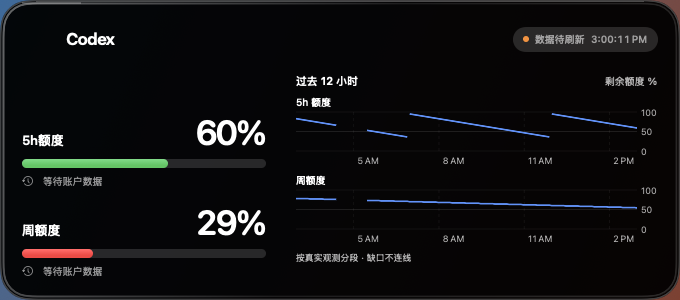

# Tallygent

讓 Agent 額度隨時可見，讓下一步安排有據可依。

[English](README.md) · [简体中文](README.zh-CN.md) · **繁體中文**

Tallygent 是本機優先的 macOS App，監測 **Codex** 與實驗性 **Claude Code** 額度，提供 **12/24 小時額度歷史**、可移動 Liquid Glass 桌面面板、Insights 分析與可解釋的 Planner 建議，不需要授予自動執行任務的權限。

## 語言支援

**English、简体中文、繁體中文**，自 v0.8.1 起提供。App 自動跟隨 Mac 的偏好語言，也尊重系統為個別 App 指定的語言；未支援的語言會回退至 English。變更語言後請重新啟動 App。日期、時間與數字格式仍跟隨系統地區設定。

這裡的 README 語言連結僅切換文件，不變更 App 或系統設定。詳見[本地化說明](docs/LOCALIZATION.md)。

## 下載與安裝

**v0.8.1（build 55）** · **macOS 14+** · **Apple Silicon / Intel 通用版本**。

[下載 DMG](https://github.com/tonig0709/Tallygent/releases/download/v0.8.1/Tallygent-v0.8.1-macOS.dmg) · [發行說明](https://github.com/tonig0709/Tallygent/releases/tag/v0.8.1) · [SHA-256](https://github.com/tonig0709/Tallygent/releases/download/v0.8.1/Tallygent-v0.8.1-checksums.txt)

1. 下載 `.dmg`，不是 GitHub 的 Source code 壓縮檔。
2. 將 **Tallygent.app** 拖到「應用程式」，退出 DMG，再啟動已安裝的 App。
3. 安裝並登入本機 Codex CLI，或包含 Codex 的受支援 Mac App；在 Tallygent 中選擇服務。
4. 選擇小、中、大面板，點擊「桌面玻璃面板」，透過「玻璃設定」調整外觀與圖表。
5. 保持 Tallygent 執行，以繼續收集新的額度觀測。關閉面板不會結束 App。

> 目前下載檔為 **ad-hoc 簽章，尚未通過 Apple 公證**。首次開啟可能需要額外的系統確認。請核對來源與校驗值，不要停用 Gatekeeper；SHA-256 證明檔案完整性，不代表 Apple 審核。見[安全說明](SECURITY.md)。

## 主要功能

- **12/24 小時額度歷史**：分別查看 5h 與每週額度，切換長條圖或折線圖。每小時長條代表該小時最後一次有效觀測，不是該小時的 Token 消耗。
- **保留七日 Token 趨勢**：大型面板可切回原有七日 Token 圖；額度百分比與 Token 不混算。
- **三種原生尺寸**：小型雙圓環 164×164pt、中型雙額度條 344×164pt、大型額度與趨勢 680×300pt。
- **一個可移動桌面面板**：在 App 中左右滑動切換尺寸；面板本文可拖移，邊緣按鈕於移入時顯示、移開時隱藏。
- **即時共用玻璃設定**：深色、淺色、自動外觀，以及不透明度、霧化、邊緣與高光等參數同步至桌面面板。
- **Monitor / Insights / Planner**：保留本機觀測、解釋使用節奏，並根據任務、可用模型、額度視窗與保留量提供 Model + Effort 建議；資料不足時會明確說明。

剩餘額度 ≥60% 為綠色、30–<60% 為橙色、低於 30% 為紅色。歷史缺口留白，重設與長時間中斷不連線，不虛構啟用前的資料。詳見[圖表含義](docs/PANEL_TRENDS.md)。

圖片來自 v0.7.1 / build 52 的原生示範資料快照，早於多語言更新，不含個人帳戶資料。[圖片來源](docs/SCREENSHOTS.md)。

## 資料來源與更新

**Codex**：主 App 擁有唯一的 app-server 連線，每 15 秒輪詢並回應額度變更通知。面板直接觀察同一狀態，不依賴 WidgetKit 更新預算。右上角每秒變化的是 Mac 時鐘，不代表額度每秒更新；實際資料新鮮度取決於服務、網路與可用資料。

**Claude Code（實驗性）**：使用者主動啟用本機 statusLine 接入，執行可提供訂閱額度欄位的工作階段。App 每兩秒讀取本機快取，不主動查詢訂閱伺服器。沒有資料時不顯示虛假的 0%；一次綁定一個工作階段，不覆寫既有第三方 statusLine。真實訂閱與不同版本相容性仍待實際帳戶驗證，不提供 Claude 七日 Token 圖。

## 隱私、升級與限制

- 歷史保留於本機，最多 30 天；提供匯出與清除，不儲存提示詞、程式碼或 Codex OAuth token。
- Claude 接入會在本機備份原設定檔，其中可能包含既有金鑰；備份權限為 `0600`。見[安全說明](SECURITY.md)。
- 不把百分比換算成 Token、費用或任務數量，不合計多個 Provider 的餘額，不在背景啟動、移轉或執行任務。
- 由 Codex Quota 升級時請結束舊副本，只保留一個使用中的安裝，不刪除本機資料。目前產品是獨立可移動面板，**不是系統小工具庫中的 WidgetKit 小工具**。
- 粒子實驗與穩定玻璃版分開維護。目前沒有 Windows 或 iOS 發行版。

## 開發與文件

需要完整 Xcode 16+。開啟保留歷史名稱的 `CodexQuotaWidget.xcodeproj`，選擇 `CodexQuota` scheme。語言資源、字體與邊界回歸見[本地化說明](docs/LOCALIZATION.md)及[版面約束](docs/LAYOUT_INVARIANTS.md)。

完整發行門禁僅能於隔離 CI 使用者執行，涵蓋 macOS 14、15、26。真實滑鼠拖移、停留、透光與連續滑桿仍需桌面驗收，詳見[發行清單](RELEASE_CHECKLIST.md)。

[英文完整說明](README.md) · [Monitor / Insights](docs/MONITOR_INSIGHTS.md) · [Planner](docs/PLANNER.md) · [產品路線圖](docs/TALLYGENT_ROADMAP.md) · [問題回報](https://github.com/tonig0709/Tallygent/issues)

獨立開源專案，不隸屬 OpenAI 或 Anthropic。原始碼採用 [MIT 授權](LICENSE)；服務名稱及圖示商標不包含在 MIT 授權中，見[商標說明](TRADEMARKS.md)。
